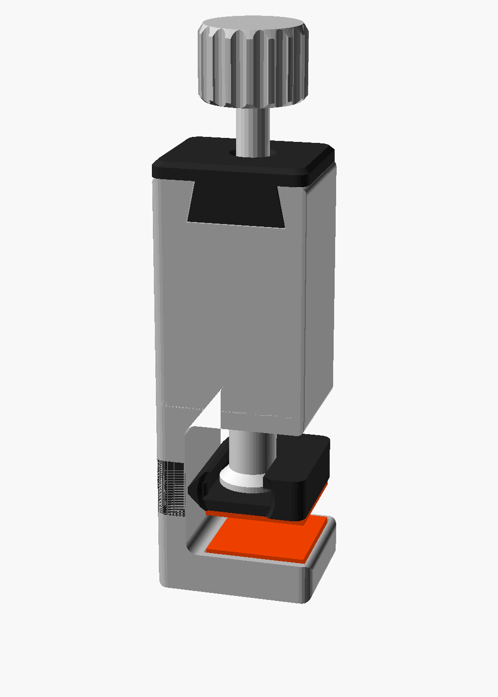
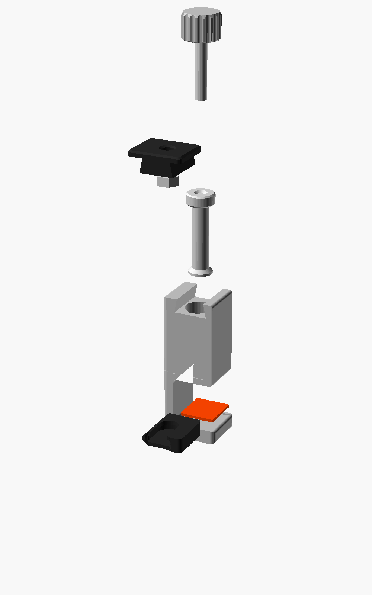

# Ekran (LCD) Sabitleme Klipsi – 3D Baskı + Metal M4 Vida

Telefon ekranı / arka kapak yapıştırırken kullanılan metal klipsin 3D yazıcıya uyarlanmış hali. Yapı orijinaliyle aynı: alt çene, kare gövde, gövdeden inen piston mil ve onun ucunda üst çene plakası, en üstte kapak ve tırtıllı topuz. Diş baskısı yok; vida ve somun hazır metal.

## Nasıl çalışır

Topuzu sıkınca M4 vida pistonu iter ve üst çene aşağı iner. Topuzu gevşetince isteğe bağlı yay pistonu yukarı iter, çene kendiliğinden açılır. Yay takılmazsa çeneyi parmakla yukarı itmeniz yeterli.

## Basılacak parçalar (1 klips)

| Dosya | Adet | Baskı yönü |
|---|---|---|
| `stl/frame.stl` – gövde | 1 | Yan yatık (dosyadaki gibi), destek yok |
| `stl/plunger.stl` – piston mil | 1 | Piston tablada, dik |
| `stl/jaw.stl` – üst çene | 1 | Yan yatık, kanal yukarı |
| `stl/cap.stl` – üst kapak | 1 | Düz yüz tablada |
| `stl/knob.stl` – topuz | 1 | Sadece DIN 933 vida kullanılırsa |
| `stl/pad.stl` – ped | 2 | TPU (yoksa 1 mm keçe/silikon kesin) |

PETG önerilir (PLA da olur). 0.2 mm katman, 4 duvar, %30+ dolgu. 4'lü set için 4 kez basın.

## Hazır metal parçalar (1 klips)

- **1× M4×20 vida:** DIN 464 tırtıllı başlı (topuz basmaya gerek kalmaz) **veya** DIN 933 altıgen başlı vida + basılan topuz (başı topuzdaki altıgen yuvaya bastırın veya yapıştırın)
- **1× M4 somun** (DIN 934)
- **1× basma yayı (opsiyonel):** dış çap ≤ 10 mm, iç çap ≥ 6.6 mm, boy 18–20 mm, tel 0.5–0.6 mm

## Montaj

1. Yayı (varsa) pistonun miline geçirin. Pistonu gövdeye **üstten** sokun; mil alttaki deliğinden çıkar.
2. Üst çeneyi yandan, mil ucundaki diske kaydırın; "tık" diye oturur.
3. M4 somunu kapağın altındaki altıgen yuvaya bastırın.
4. Kapağı gövdenin üstündeki kırlangıç kuyruğu kanala yandan kaydırın.
5. Vidayı kapaktan geçirip somuna takın. Vida kapağın kayarak çıkmasını da engeller.
6. Pedleri alt çenedeki yuvaya ve üst çenenin altına yapıştırın.

## Ölçüler

- 16 × 20 mm taban, kapak üstüne kadar 54.7 mm (topuzla ≈ 64 mm)
- Çene açıklığı 0–12 mm (pedlerle ≈ 0–11 mm)

## Ayarlar

`lcd_clamp.scad` dosyasını OpenSCAD'de açın (Customizer):

- `slide_clr` – piston sıkı kayıyorsa artırın (0.3–0.35)
- `cap_clr` – kapak kanala girmiyorsa artırın
- `hex_clr` – somun yuvaya girmiyorsa artırın
- `max_open`, `reach`, `W` – açıklık, derinlik, kalınlık

STL üretmek için: `openscad -o stl/frame.stl -D 'part="frame"' lcd_clamp.scad`. Diğer `part` değerleri: `plunger`, `jaw`, `cap`, `knob`, `pad`, `plate`, `assembly`, `exploded`.
